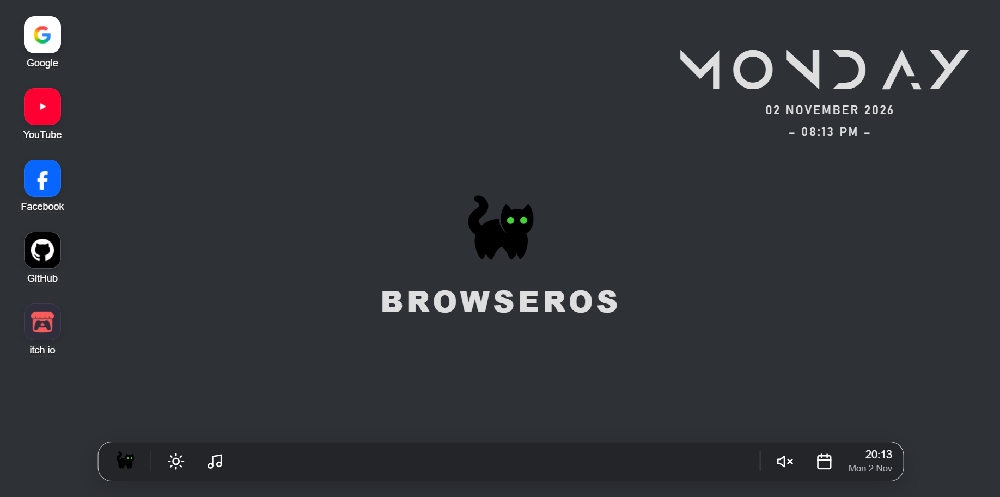
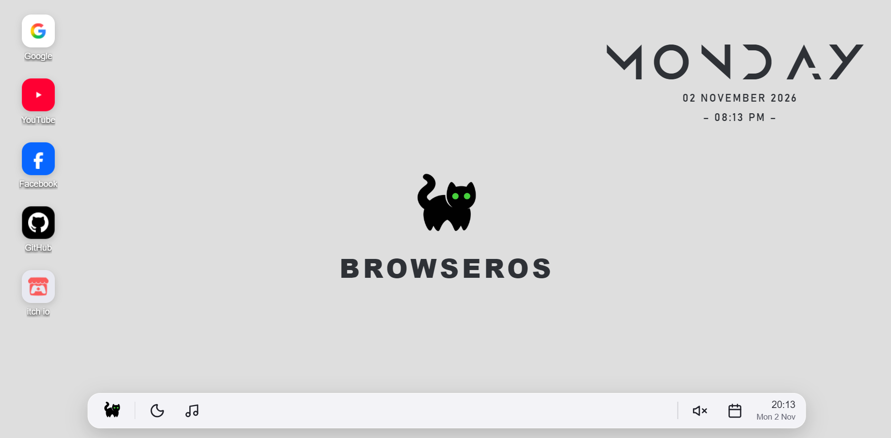

# BrowserOS

A desktop-style new tab for your browser. Turn your bookmarks into app shortcuts, choose your wallpaper, and make the space your own.

Built with HTML, CSS, and JavaScript. No build step or account needed.

## Preview

### Dark mode



### Light mode



These screenshots show a customized setup. Google, YouTube, and GitHub are the three default apps; other shortcuts come from your bookmarks or apps you add.

## Features

- **Desktop apps:** add, rename, change, and remove website shortcuts without editing code. Drag them to any desktop grid cell; their positions stay saved.
- **Browser bookmarks:** bookmarks from your folders appear as apps and refresh when they change. Duplicate website addresses are shown once. Only HTTP and HTTPS links are included.
- **Start menu:** click the cat button to open a searchable app launcher. Switch between an icon grid and a list with icons beside the names.
- **App colors:** use a website icon's sampled color, reverse a black/white tile, or uncheck **Enable icon color** to use the current theme's neutral tile color.
- **Light and dark modes:** switch themes from the taskbar. Your choice is remembered.
- **Custom wallpapers:** choose a still image, animated GIF, or compatible MP4. Videos loop silently. **Default wallpaper** restores the centered cat and BROWSEROS design.
- **Background music:** choose a local audio file and let it loop. The speaker button mutes or unmutes it, and remembers your preference.
- **Desktop clock widget:** an Anurati weekday heading with the date and time, shown in the upper right by default. Drag, resize, recolor, hide, or reset it.
- **Clock and calendar:** the taskbar clock updates automatically. The calendar shows the current month, highlights today, and lets you browse other months.
- **Personal profile:** click the profile picture to replace it, or click the username to edit it.

Your apps, layout, profile, theme, media, and widget settings are saved locally in the browser profile.

## Install

### Before you start

1. Download the project ZIP and extract it, or use your existing BrowserOS project folder.
2. Find the folder containing `manifest.json`, `index.html`, `style.css`, and `index.js`.
3. Keep the `wallpaper` and `fonts` folders alongside those files.

Choose the folder containing `manifest.json`, not the ZIP or an outer folder that only contains another folder. Keep the installed folder in the same location afterward.

Opening `index.html` directly does not install the extension or provide its bookmark features.

### Brave

1. Open `brave://extensions` in the address bar.
2. Turn on **Developer mode**.
3. Click **Load unpacked**.
4. Select the BrowserOS folder containing `manifest.json`.
5. Review any permission prompts and enable the extension if asked.
6. Open a new tab. If Brave asks about the new-tab replacement, keep the change.

For the browser's unpacked-extension workflow, see the [Brave installation instructions](https://community.brave.com/t/debugging-custom-extension-add-ons/169217).

### Google Chrome

1. Open `chrome://extensions` in the address bar.
2. Turn on **Developer mode**.
3. Click **Load unpacked**.
4. Select the BrowserOS folder containing `manifest.json`.
5. Review any permission prompts and enable the extension if asked.
6. Open a new tab and keep BrowserOS as the new-tab page if prompted.

This uses Chrome's [official unpacked-extension installation process](https://developer.chrome.com/docs/extensions/get-started/tutorial/hello-world#load-unpacked). Chrome is a target browser, but this project has primarily been used in Brave; it has not had a full Chrome-specific test pass.

### Firefox — developer testing only

**The current package targets Chromium browsers. Firefox compatibility has not been verified, and a signed Firefox build is not included.** Loading it temporarily does not guarantee that every feature will work. Chromium-specific favicon access and extension API differences need a Firefox compatibility pass.

To attempt a temporary developer test:

1. Open `about:debugging#/runtime/this-firefox` in Firefox, or open `about:debugging` and select **This Firefox**.
2. Click **Load Temporary Add-on**.
3. Select `manifest.json` inside the extracted BrowserOS folder.
4. Check any installation errors or warnings before opening a new tab.

If Firefox rejects the manifest or a feature fails, this build needs compatibility changes; these steps do not convert it into a Firefox version. Temporary extensions are removed when Firefox restarts. A normal persistent Firefox install requires a Mozilla-signed package. See Mozilla's [temporary installation guide](https://extensionworkshop.com/documentation/develop/temporary-installation-in-firefox/) and [browser compatibility notes](https://developer.mozilla.org/en-US/docs/Mozilla/Add-ons/WebExtensions/Chrome_incompatibilities).

## Quick use

| What you want to do | Where to find it |
| --- | --- |
| Open the start menu | Click the cat on the taskbar. |
| Add a website app | Open the start menu and choose **+ Add app**. |
| Edit an app | Right-click it and choose **Edit app**. |
| Move an app | Drag it onto a desktop grid cell. Dropping onto another app swaps their cells. |
| Change an app's tile | Right-click it and toggle **Enable icon color**. Black/white tiles also have a reverse option. |
| Search or change the app view | Use the search field and grid/list buttons in the start menu. |
| Change the wallpaper | Use the wallpaper button in the start menu. |
| Restore the built-in background | Choose **Default wallpaper**. |
| Change the theme | Click the sun/moon button beside the cat. |
| Add or change music | Click the music-note button on the taskbar. |
| Mute or unmute music | Click the speaker beside the calendar. |
| Show or hide the desktop clock | Use the clock button above the wallpaper picker in the start menu. |
| Resize or remove the clock | Hover over it to reveal its corner handle and **×** button. |
| Change the clock color or reset it | Right-click it and choose **Text color** or **Restore defaults**. |
| Open the calendar | Click the calendar button beside the taskbar clock. |

The desktop clock also supports keyboard controls: focus the widget and use the arrow keys to move it, or focus its resize handle and use the arrow keys to resize it. Hold **Shift** for larger steps.

### Removing apps and bookmarks

Right-click an app and choose **Remove app**. The dialog offers:

- **App only:** hide it from BrowserOS and keep the browser bookmark.
- **Bookmark only:** delete the matching bookmark and keep a local app shortcut.
- **Both:** remove the app and delete the matching bookmark.

The dialog shows how many matching bookmarks will be deleted. Multiple bookmarks pointing to the same exact website address can be affected. Editing an app changes its BrowserOS shortcut, not the original browser bookmark.

## Permissions and local data

| Permission | Why it is used |
| --- | --- |
| `bookmarks` | Display browser bookmarks and delete them only when you choose a bookmark-deletion option. |
| `favicon` | Access the Chromium browser's stored website icons. |
| `unlimitedStorage` | Provide room for saved wallpapers, videos, music, and other local settings. |
| Optional access to individual websites | Fetch an icon for color sampling when you explicitly enable access to that website. |

The code does not include an analytics service or an upload server. Uploaded media and settings are stored locally, without cloud sync. Website-icon requests can still contact the corresponding website.

Local-page settings, extension settings, and settings in different browsers or profiles are separate. Removing the extension or clearing its data can remove saved customizations. A backup of the project files does not include the settings stored inside your browser.

## Updating

Replace the files in the same installed folder. Open `brave://extensions` or `chrome://extensions`, click **Reload** on BrowserOS, then close old BrowserOS tabs and open a fresh one. Review new permissions if the browser requests them.

Keep one main installed copy. Updating another extracted folder will not update the copy your browser is using. For Firefox temporary testing, use **Reload** on its card in `about:debugging`.

## Troubleshooting

- **The old design still appears:** check which folder the browser loaded, reload the extension, and open a fresh tab.
- **The browser says a permission was not declared:** reload the extension itself so its current manifest takes effect; refreshing the tab alone is not enough.
- **An icon's background stays neutral:** sampling may be blocked or unavailable. Try its right-click color option and approve website access if you want to use it. You can leave icon color unchecked to keep the theme's default tile.
- **Music does not start immediately:** the browser may require a click or key press before it allows audio playback. Each BrowserOS tab has its own player.
- **An MP4 will not play:** try a browser-compatible MP4, preferably H.264. Wallpaper videos are muted; use the separate music player for audio.
- **A removed clock is missing after restart:** that is saved intentionally. Bring it back with the clock button in the start menu.
- **A browser footer appears below the desktop:** where available, right-click the footer and choose **Hide footer on New Tab page**. It belongs to the browser, not BrowserOS.

## Project files

```text
Browser OS/
├── manifest.json          Extension configuration and permissions
├── index.html             Desktop, menus, controls, and dialogs
├── style.css              Themes, layout, and component styles
├── index.js               Apps, bookmarks, media, widgets, and saved settings
├── fonts/Anurati.otf       Weekday display font
├── wallpaper/             Local icon and wallpaper assets
├── docs/screenshots/      Dark and light preview images
├── INSTALL.txt            Short installation guide
└── README.md              This guide
```

Interface icons use [Lucide](https://lucide.dev/). The weekday widget uses the bundled **Anurati** font.
